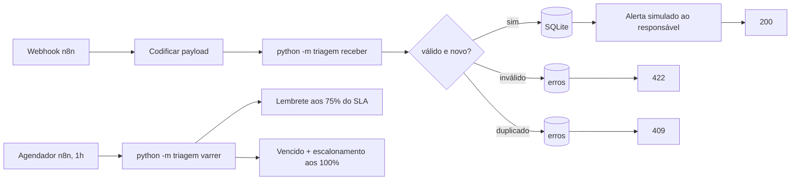

# Triagem automática de pedidos de orçamento

Projeto de portfólio de automação de processos. **Tudo é fictício**: empresa (Marcenaria Pinheiral), pessoas, e-mails e pedidos foram inventados. Não há clientes, uso real nem resultado de mercado. As métricas são simulação.

## Problema
Pedidos de orçamento chegam sem padrão (nome em maiúsculas, contato faltando, prazo escrito "quando der", o mesmo pedido enviado duas vezes) e ninguém cobra quem esqueceu de responder. O arquivo [`data/pedidos_exemplo.json`](data/pedidos_exemplo.json) reproduz essa bagunça em 10 pedidos: é o "antes".

## Desenho


Versão em texto:
```
webhook (n8n) ─► python -m triagem receber ─► validar ─► duplicado? ─► classificar ─► SQLite ─► alerta simulado
                         └── erro tratado: registra em `erros`, devolve JSON ok=false, fluxo segue
agendado (n8n, 1h) ─► python -m triagem varrer ─► lembrete (75% do SLA) ─► vencido + escalonamento (100%)
```
- **Python** guarda toda a regra (`src/triagem`), testada com pytest.
- **n8n** só orquestra: chama o CLI e ramifica pelo JSON de saída ([`n8n/`](n8n/)).
- **SQLite**: tabelas `pedidos`, `historico_status`, `notificacoes`, `erros`.
Para treinar a explicação: [`docs/roteiro-entrevista.md`](docs/roteiro-entrevista.md).
Regras completas: [`docs/especificacao.md`](docs/especificacao.md). Métrica: [`docs/metrica.md`](docs/metrica.md).

## Decisões
- *n8n fino + Python*: a lógica fica testável sem subir o n8n e fácil de explicar.
- *SQLite*: arquivo único, zero instalação; o SQL serviria igual no Postgres.
- *Alerta simulado*: sem credenciais nem envio a terceiros; trocar por e-mail ou Telegram é mexer só em `notificar.py`.
- *"agora" injetável*: as regras de prazo recebem a hora como parâmetro, o que permite testar lembretes sem esperar.

## Limites
- O nó Execute Command do n8n exige n8n local; não serve na nuvem gratuita.
- O workflow do GitHub Actions (`.github/workflows/tests.yml`) foi escrito mas nunca executado.
- Os fluxos n8n foram testados num n8n 2.47.7 local (200/422/409, lembrete e escalonamento), mas só no Windows e o agendamento de 1 hora não foi esperado de fato (ver [`docs/rodar-n8n.md`](docs/rodar-n8n.md)).
- Classificação por palavras-chave: simples de defender, mas erra textos que fogem do vocabulário (caem em `indefinido` para triagem manual).
- Métrica baseada em premissas inventadas.

## Como rodar
```bash
python -m venv .venv
.venv/Scripts/pip install -e .[dev]   # Linux/macOS: .venv/bin/pip
.venv/Scripts/python -m pytest        # 78 testes, incluindo ponta a ponta
```
Uso manual do CLI:
```bash
echo '{"nome":"Ana","contato":"ana@exemplo.test","descricao":"cozinha planejada"}' | .venv/Scripts/python -m triagem receber --db triagem.db
.venv/Scripts/python -m triagem varrer --db triagem.db
.venv/Scripts/python -m triagem responder --db triagem.db --id 1
.venv/Scripts/python -m triagem metrica --db triagem.db
```
